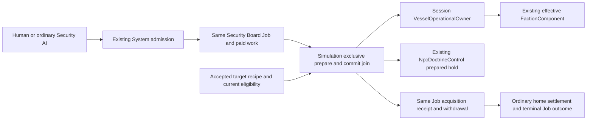

# Integrated acquisition and guided-loading ownership

Source pin: `0ca0d9860bed7b03d4c3e822a668f8b9747a2e03`, 16 October 2026.
This describes integrated code, not native/playable acceptance. At that pin the
acquisition, shared-loader and EMP packets were integrated and owner tests were
pending. It does not adopt the separate proposed Patrol return contract.

## Whole-vessel acquisition

[Architecture declarations](../../pasm/spec/architecture/vessel-acquisition.yaml)
separate actual ownership from typed values and the cross-owner commit adapter.

| Existing module/type | Responsibility |
|---|---|
| Model `vessel_ownership.rs` | Closed `SecurityAcquisitionOrder`, `VesselAcquisitionCause` and `VesselOperationalOwnerData` values, identity/clock validation and serialization. The cause is embedded data, not a separate pool or action executor. |
| Session `vessel_ownership.rs::VesselOperationalOwner` | Sole optional canonical operational-owner component on the acquired vessel. `acquire` refuses replacement; it does not change Station claims or System command admission. |
| Gameplay `jobs/security.rs` | Same finite Security TeamJobs retain original acquisition order, useful-work receipt, withdrawal result and eventual terminal result. Receipt history does not become another owner-selection authority. |
| Simulation `security/acquisition.rs` | `commit_ready_acquisitions` joins paid Board work to prepared Session authority and the existing doctrine owner. It runs exclusively immediately after the ordinary paid Security tick, in deterministic actor/team order. |
| Existing `NpcDoctrineControl` / `NpcDoctrineState` | Prepare and commit the accepted base-World nonempty all-None hold using the existing ordinary doctrine transaction. State and baseline remain at this owner; acquisition adds no controller. |
| Existing `FactionComponent` | Effective projection: original accepted recipe without acquisition, frozen Session owner faction after acquisition. It is not independently saved as another editable allegiance. The global FactionRegistry still owns faction definitions/relationships. |
| `AcquisitionTargetDefinition` | Immutable accepted original-faction recipe, declared DeferredFold with zero independent folded fields. It is not live ownership or personnel state. |

The first effect applies only to genuinely uncrewed, actually disabled,
non-player NPCs with an accepted explicit Board acquisition effect. Canonical
checks at commit include actual target state, current player/Human/GM exclusions,
registered acquiring faction and no existing operational owner. Another actor's
competing completion cannot replace the first owner. There is no eligibility
cut to power, synthetic repair, prize crew or replacement physical entity.

Knowledge and authorization are separate checks. Acquisition offers, Human
selection and ordinary AI selection use Security's permitted selectable,
nonpredicted contact alias with an observed disabled assessment. The commit
adapter then validates physical/authority truth. Its internal UUID association
is not an operator feed. The first explicit effect does not widen ordinary
Security action knowledge or grant captured Console history to the acquirer.

A prepared doctrine must succeed before Session ownership/faction and same-Job
success are committed. Preparation failure records a failed withdrawal on that
same Job; consumed work is not refunded. Successful useful work does not release
the team: `returning_outcome` remains separate from terminal `Job.outcome` until
actual home settlement. Ordinary flag-only Security actions keep their original
consequences; acquisition is a distinct explicit effect, not an inferred flag.

Doctrine hold is initial compatible intent. Later legitimate doctrine selection,
GM puppeting, controller presence, repair or faction changes on the original
acquirer do not rewrite the acquisition event. `acquired_tick`, cause and original
hold identity are historical. Acquirer loss does not revert the acquired asset
or authorize a substitute player. Remote orders, succession, populated capture
and Patrol completion are not supplied by this record.

### Continuation and data flow

`EntityState.operational_owner` captures the canonical optional value; the
UUID-sorted `vessel-ownership-namespace` folds it completely. The original
acquisition cause also remains in the same Security Job while that history is
retained. No new event archive, global timer, job mint or transport is installed.

`security/acquisition.rs`, `snapshot/vessel_ownership.rs` and
`snapshot/security.rs` validate accepted target effect/recipe, frozen registered
faction, original base-World hold, cause clocks, actual finite team and consumed
Security Job mint. Available matching original Job/target history must agree;
one Job cannot acquire several vessels. Row-local and whole-candidate doors
validate before writes, including canonical Disabled actors.

Historical validation deliberately does not rerun today's disablement, current
crew/GM eligibility, live issuer survival or present faction equality as proof
of a past event. Removed actors can leave real retained history. These are
structural/provenance and available-record consistency guards, not authentication
against coordinated rewriting of every historical fact.

`snapshot/application.rs` restores Session ownership and its effective faction,
or clears ownership and restores the accepted original faction, before ordinary
consumers resume. The existing doctrine snapshot independently restores its
selected intent. Acquisition revalidates subsequent faction-sensitive target
locks; already emitted projectiles and other physical consequences survive.

## Optional shared guided loading

The integrated implementation keeps this inside the existing
[ammunition-stock owner](../../pasm/spec/architecture/resource-stores.yaml) and
[common weapon compilation](../../pasm/spec/architecture/configurable-weapons.yaml).

- Model's shared-loader types describe own priority/waiting projections. They do
  not own a queue, magazine, worker or simulation tick.
- Authored `LoaderGroupConfig` is immutable accepted membership and work rate.
  Existing `TorpedoSystem` contains those groups and each tube's `load_priority`.
- `loader_order` deterministically ranks grouped tubes by priority, committed
  loading/unloading status and actual SystemId. Independent members retain
  relative order; groups do not lend capacity to other groups or independents.
- Per-step `loader_budgets` and `loader_wait` are derived. Current magazine
  Operation scales finite aggregate handling; actual tube progression remains
  bounded by its own stage/time, real paid work and the same Stock reservation.
  Priority changes preserve existing partial progress and claims.
- `handle_torpedo_magazine_inter_system` remains the claim/payment consumer.
  `console/weapons/shared_loaders.rs` finishes correlated load feedback from that
  actual result; it is not another loader executor. Human and ordinary AI use the
  same System-addressed admission and per-tube information scope.
- Entity capture includes priority only for grouped tubes; preflight requires
  exact grouped presence and rejects a priority on independent tubes before
  writes. Restore applies it to the same owner and clears derived waits. The
  existing resource digest folds actual grouped priority; independent legacy
  contributions remain unchanged.

Source files: `crates/phoenix-sim-gameplay/src/weapons/shared_loaders.rs`,
`weapons/torpedo.rs`, Simulation `console/weapons/{torpedo,guided_advance,shared_loaders}.rs`,
`snapshot/{schema,capture,preflight,application}.rs` and `sim_digest.rs`.
No separate loader state resource, reservation ledger, capacity battery or
per-group controller is added.

## Evidence boundary

This companion records source ownership and data flow only. Owner/host native
checks, device/network acceptance, balance, workloads and full increment exits
require their separately pinned evidence. Documentation validation is not a
claim that acquisition, shared loading or the Patrol run passed those checks.
