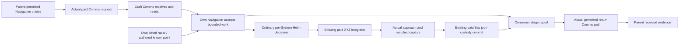

# Draft: first moving carried craft

**Reviewed proposal, superseded by the adopted [implementation contract](increment-19-moving-craft.md).** Root selected the first unarmed utility shuttle, physical launch home provenance, transmitted known XYZ waypoint and data-authored matched capture. This proposal retains the owner audit and alternatives for context; the adopted contract and PASM govern implementation. No moving runtime or completion is claimed, and fixed-craft native checks must clear before implementation.

## Proposed playable increment

Author one ordinary AI utility shuttle, launch it through the real Bay, send it
to a known authored point with nonzero altitude, then recall it to a stopped
carrier for real approach, speed matching and paid recovery. Keep the same entity,
local energy, damage, onboard work and dated observations throughout. An armed
fighter can follow after this travel/return consumer works; it reuses the existing
weapon machinery. Passenger travel joins actual increment20 custody separately.

The shuttle uses the existing ordinary hull installation, paid Helm axes, sole
ShipPhysics integrator and individual System AI. `Full3D` currently supports XYZ
translation with yaw. The actual vertical AI only supplies moving-hazard climbs;
it does not yet fly to a selected altitude. The enum's six-degree-of-freedom
comment is not evidence of pitch/roll control. This increment proposes the
missing destination/return consumer on existing axes, without another physics
engine/controller or a promise of Human vertical piloting. Capital ships retain
their existing planar/bounded modes, screens and supported journeys.

## Existing owners and required joins

| Mechanism | Existing evidence | Required moving-craft join |
|---|---|---|
| Ordinary ship | `entities/ship_spawn.rs` installs equipped behaviour-driven hulls, ordinary per-System sources/trees and actual physics. | One fully accepted authored AI hull, with explicit Console feeds, physical layout/damage and real finite energy for every fitted actuator/instrument. No projectile controller or new craft-family controller. |
| XYZ movement | Gameplay `ship/physics.rs` already integrates forward/lateral/vertical velocity and yaw; `ship/helm_ai/vertical.rs` supports `Full3D` hazard climbing. | Feed a permitted dated 3D destination/return demand into the existing Navigation/Helm plan and ordinary axis decisions. The sole paid integrator moves the body. Missing altitude evidence cannot become zero-height/private-world pursuit. |
| Knowledge | `ObservedElevation` belongs to the same dated measurement as planar position and includes error and optional measured vertical velocity. | Explicit own Navigation/Helm feeds consume current earned XYZ evidence. Co-hosted Consoles do not pool knowledge. A Comms sender UUID alone does not associate a radar contact or grant its position. |
| Sortie work | Shared `Job` supplies finite work, pause, outcome and identity; Bay jobs already own launch/recovery only. | One actual onboard Navigation work record owns the accepted bounded trip/return workflow. Navigation remains the course owner; the work record contains no second pose, actuator plan or resource mirror. Parent views derive from its own Bay records, actual sent/returned receipts and observations. |
| Handling | Bay readiness uses actual parent/access/Operation/Power/current contact/range/space; completion rechecks at end-Physics before ordinary Rapier sync. | Add actual child relative-motion/capture feasibility before paid recovery and at commit. Far or fast craft cannot be stowed by selecting Recover. Unready work pauses through the existing Job; the ordinary ship approaches/brakes. |
| Custody/presence | `ProbeCustody` is canonical; Carried derives Disabled/backend removal and actual reserve aging. Fixed profiles currently require zero motion/roll everywhere. | Validate mode against exact installed Helm capability. A deployed ordinary moving hull may have finite allowed motion; a Carried body is inactive with capture-settled motion. Preserve ordinary initial pose rather than overwriting an already-installed ShipPhysics. Existing fixed recipes keep their strict zero-motion boundary. |
| Continuation | Existing snapshots/digests retain hull, work, knowledge, resources and custody; full-candidate checks precede writes. | Bind installed movement capability, active course/work/order, capture conditions and actual location before restore. Rebuild only derived input/backend state; never launch, move, refill or complete work during restore. |

## Knowledge and command flow

A static authored point is a coordinate instruction, not a claim that a hidden
actor is present there. Recommend the first outbound instruction select a known
accepted XYZ waypoint already published to the parent, then deliver that closed
finite point through actual Comms. It must not transmit private content paths,
world-global actor IDs or arbitrary executable actions. The craft rechecks its
own authority and viability before creating work and its normal course.

Returning to a moving body requires current own measured position, altitude and
motion. Recommend an explicit home-identity receipt from the actual launch
relationship, carrying identity and the original launch frontier only. That
receipt grants no continuing pose/velocity or new radar observation. Its route
must still resolve through the receiving craft's currently permitted measured
contact; ambiguity, stale data or absent height pauses/surfaces the reason.
Root must review whether that physical home association is the selected contract
or whether first return instead requires independently matched public identity
as in Formation. Neither choice permits searching the private Broad source map
as identity evidence.

## Required increment16 and sortie joins

These are required real consumers, not assumed capabilities of the fixed turret
or identity decoy:

1. A closed travel/return request definition, its actual receiving Comms owner,
   reading lifecycle, parameter bounds and exact issuing sequence/work identity.
   Acceptance offers supported local Navigation intent; it cannot force another
   Human-controlled System or bypass ordinary command/mission priorities.
2. Explicit expiry and supersession scope using existing received knowledge.
   Duplicate or delayed older envelopes cannot replace newer accepted work.
   An unseen recall/cancellation cannot alter a disconnected craft.
3. Distinct delivery, read, accepted/refused, executing/paused, arrived/returning
   and physically recovered evidence. A Comms Accept is not Navigation execution,
   an arrival report is not a Bay handoff, and local host truth is not a returned
   receipt. Reports must name the actual accepted request/work/craft frontier so
   an earlier sortie cannot satisfy a later one.
4. Ordinary onboard continuation during link loss. Accepted work remains with its
   local AI and real constraints. Failed receipt delivery leaves the parent
   uncertain; it does not stop work, destroy the craft or create remote telemetry.
   Do not promise a new remote order until the real request has arrived/read.
5. Actual return and recovery: the craft's ordinary Helm flies/brakes; the Bay's
   own authority admits handling after feasibility. The existing Bay Job owns
   finite handling, capacity and its physical receipt. No parent instruction
   writes a remote body pose or deposits it directly into Carried custody.

No second comms network, actor registry, passenger inventory, physics writer,
resource ledger or mission planner is introduced. The first consumer is local
flight in the existing World; inter-system transit and broader campaign travel
remain their own accepted mechanisms.

## Root review decisions before PASM/code

- Confirm an unarmed AI utility shuttle first, then an armed derivative, rather
  than hiding a new family of mechanics behind a moving-body flag.
- Confirm the ordinary Navigation/shared-Job owner and precise relationship to
  existing course generation, priorities and retained per-System AI memory.
- Select how a legitimate launch relationship establishes home identity without
  granting live position, and the permitted authored XYZ waypoint publication.
- Pin a data-driven capture feasibility contract: child relative speed and actual
  approach/capture geometry, alongside the existing stopped-parent threshold.
  Existing Dock has marker geometry/approach work; it does not already supply a
  moving-craft Bay relative-speed rule. Reuse its mechanics where compatible,
  without allowing Dock and Helm to compete as pose writers.
- Select the actual increment16 request/receipt vocabulary and supersession key.
  Do not repurpose ReportStatus, FormUp Accept or facility reception as a fake
  travel-completion receipt.

## Verification boundary

Prove normal Human/ordinary AI launch and recall; actual paid nonplanar travel,
own earned target/height handling, fuel/energy constraints, approach/braking and
same-body recovery. Lose the real radio path, withhold/stale the actual target
measurement, delay an older recall, interrupt recovery and remove the actual
parent. Check that onboard work and parent uncertainty behave independently.

Use fresh complete JSON/digest continuation for launch, nonzero-altitude moving
flight, a real link gap, return approach and paid recovery, with full no-write
forgeries of movement/custody/order/work/capture bindings. Exercise another
LocalShip observer and the actual Workshop accepted recipe/Preview/Test path.
A scripted position change, projectile-style flight or direct private target
lookup does not establish this playable exit. Performance, native/browser and
2/4/6/8-seat journeys remain separately recorded acceptance.
