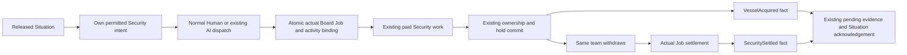

# Bind vessel acquisition to a real planned activity

**Adopted implementation contract, 16 October 2026. Source implementation awaits native integration verification.**
Root adopted the independently reviewed contract with unavailable acquisition
remaining pending; it adds no new unaccepted-task terminal lifecycle.
This is a bounded increment 22/23 prerequisite. It connects the existing paid
Security acquisition to the existing Situation/HTN evidence path. It does not
deliver Patrol return, external repair, remote Navigation, negotiated surrender,
passenger transport or another continuing mode. See [increment 22](increment-22.md),
[increment 23](increment-23.md), the [acquisition contract](capture-acquisition-contract.md)
and [PASM decision](../../../pasm/spec/design/vessel-acquisition-activities.yaml).

## Audited baseline

Source: `256911e6b27ab05521271e73d6065b9e4aba481d`. The isolated source audit ran
`uv run pasm design digest pasm/spec --workspace-root .` before this proposal.
It completed successfully and reported the existing convoy, elimination and
Falling Skyway anchors. There is no Patrol anchor from which to select timing,
difficulty or a return deadline. This proposal changes no scenario values.

The physical acquisition and ownership owner are implemented. Security dispatch
mints a normal finite TeamJobs JobId, records SecurityAcquisitionOrder, pays for
work and reaches the same-step exclusive ownership/doctrine transaction. The
actual result is retained in that Job while its team withdraws. SecurityJobs.home
sets the terminal Job.outcome only at actual settlement. Neither result is yet a
World Activity outcome; the existing activity families are internal repair,
local delivery and ReportStatus.

The first consumer remains the accepted external-capable Security profile and
an opt-in, genuinely uncrewed, recoverable disabled non-player vessel with an
explicit compatible all-None hold doctrine. A local-only Cruiser does not gain
external boarding. Populated vessels, prize crews and negotiated surrender stay
unsupported. The acquisition-time and historical eligibility rules in the
existing acquisition contract remain unchanged.

## Typed source and execution bindings

Add `ParameterKind::Vessel` and `Value::Vessel(String)` to the existing closed
planning schema. It is an immutable **subject reference**, not another executing
actor, contact alias, live entity handle or authority grant. Apply the existing
bounded text/closed-key rules, reject `slot:` subjects, and require an exact named
base-World entity with accepted acquisition-compatible equipment. Reject unknown,
dynamic, layer and player-slot targets before Preview/Test. No raw UUID fallback
or name guessing is supported.

Keep exactly one `Value::Actor` root argument. `root_actor` continues rejecting
multiple executing Actor arguments; Vessel values are not counted as Actors.
Existing Actor/recipient meanings and ReportStatus-only guards are unchanged.
Persist Vessel arguments through the existing immutable PlanChoice.root_arguments
and source graph; there is no new subject registry or PlanChoice UUID cache.

The new `OperatorFamily::AcquireVessel` and `RequestTemplate::AcquireVessel` use
the closed arguments below. Domain imports must explicitly require this family.

| Field | Source type | Meaning |
|---|---|---|
| actor | Actor | The one executing crew ship, bound through existing base/slot provenance |
| owner | System | Its actual Security System; the first physical owner remains `security` |
| team | Team | One real finite Security team index |
| target | Vessel | The exact accepted named base-World acquisition subject |

`ActivityRequest::AcquireVessel { actor, owner, team, target }` retains the authored
target reference, as Communication retains its authored recipient reference.
Simulation resolves it privately through the accepted base identity map at the
ordinary physical boundary. The runtime request's actor binds to the actual crew
UUID through the existing actor mechanism. A missing subject identity withholds
admission; it does not change the chosen method or select another ship.

Immutable source validation checks the actor's actual Security owner/team/external
capability and the target's accepted acquisition opt-in, original uncrewed recipe
and supported all-None doctrine. Perform this target check in the accepted World
closure as well as historical preflight; the current actor-only supports_recipe
helper cannot establish a foreign target's immutable capability by itself.
Current contact, disabled condition, faction, range, crew/control and operability
remain normal physical admission/completion checks, not method-selection inputs.

## One ordinary dispatch and one physical Job

Release the leaf using the existing Situation engine. Derive a bounded own
Security planned-intent row from the current released, unaccepted leaf. It carries
the ordinary Situation identity/release clock/team and a target alias only after
the same Security Console independently holds the current selectable, assessed
disabled contact. Resolve with the existing acquisition_alias/contact-routing
rules. Do not publish the private source UUID, authored target name, recipe or
another Console's knowledge. An unpublished/unknown row does not prevent the
owning player from using their normal tools to find the vessel.

Human and the existing ordinary Security AI consume the same permitted row. AI
prioritizes it within its current cadence/controller and emits the same admitted
DispatchSecurityTeam action `board`. Human dispatch stays the same command.
Neither controller can dispatch a hidden target or force another System to act.
There is no separate mission controller, temporary Backfill policy or free work.

After normal authority, alias, target-action and dispatch checks, prepare the
normal SecurityJobs deployment and matching Situation acceptance together. Bind
the **newly minted actual** ActivityJob(actor, owner, JobId), team, resolved target,
accepted acquisition effect and original admission tick before any paid progress.
Commit both candidates only after all matching/uniqueness/evidence-capacity checks
pass. A matching ambiguous or malformed binding must not leave a deployed but
unbound planned Job. Normal unrelated dispatch with no matching leaf remains
ordinary unscoped work. No new command payload context is required for this first
consumer: exact actor/owner/team/target/effect matching must identify at most one
eligible released leaf.

Same-actor/System requests conflict on either the same finite team or the same
subject until the earlier actual Job settles. Different actors can still compete;
the existing physical acquisition transaction selects at most one owner and
produces honest failure/return for the loser. Planning does not reserve a target,
team, fuel, access, future power or a physical resource merely by releasing a leaf.

Independent AI/Human acquisition before release is never credited retrospectively.
An unavailable subject or a normal admission refusal leaves the released activity
unaccepted and pending: no Job, physical fact, success dependency or promise change.
The owner can display its ordinary permitted readiness/refusal. Its missing action
or contact is not proof of acquisition, destruction or a failed physical Job.
A captured target leaves the ordinary candidate pool; the planned-intent adapter
must not reintroduce it as an executable Board target or repeatedly mint work.

Retain the chosen root, subject, original release and any required promise. Do not
add an acquisition-specific unavailable field, condition, receipt or terminal
lifecycle; do not manufacture Cancelled settlement or automatically keep/break a
promise. Actual failures after a real binding use the same Job's SecuritySettled
outcome and normal Scenario conditions. Unknown or foreign private ownership
cannot supply a crew fact or retrospective acceptance.

This first consumer does not automatically close or replan an unaccepted changed
goal. Existing changed-work monitoring is restricted to optional maintenance's
final compartment-Structure Repair node; it is not generic AcquireVessel support.
If a later authored Patrol chain needs changed-goal closure, extend that common
bounded disposition/Scenario mechanism with an explicit own-permitted Security
reading and source policy, preserving accepted work and history. Do not silently
reuse Repair-only readings, switch methods or reset deadlines in this slice.

## Two causal facts with different clocks

Keep ActivityExecutionIdentity::Physical with the actual existing JobId. Add only
the two closed outcomes and evidence keys required by this physical consumer.

| Fact | Exact source | Clock and interpretation |
|---|---|---|
| `VesselAcquired { vessel, ownership }` | Successful existing Session owner + prepared NPC hold doctrine commit | Original acquired/work-completed tick; useful achievement, not a free team |
| `SecuritySettled { vessel, outcome }` | The same real Security Job's transition to terminal outcome | Actual settlement tick; Completed/Failed/Cancelled, never inferred from elapsed forecast or withdrawal |

`vessel` is the immutable authored subject reference used by this request.
`ownership` is the exact existing VesselOperationalOwnerData receipt, including
its SecurityBoard cause with actual canonical target UUID, scoped Job/team,
original accepted/work-completed clocks, frozen faction and hold doctrine. This
is evidence of the existing transaction, not a second operational owner. Pure
Situation matching compares the source reference; Simulation and whole-candidate
validation join its actual cause target to the accepted base identity mapping.

VesselAcquired validates exact fact scope == cause.scope, request team/subject,
controller == executing actor and fact.tick == ownership.acquired_tick ==
cause.work_completed_tick. Its original accepted tick must equal the same
Situation/physical order admission clock and precede completion. Stage the fact
in the successful exclusive commit before withdrawal/publication can expose the
frontier. Failed acquisition preflight produces no achievement. Emit terminal
settlement from the actual owner transition, including supported interrupted or
unavailable outcomes, before the finite team slot can be reused. Preserve whatever
terminal outcome the physical owner actually produces; do not add a new return
failure model. Settlement never erases or undoes the acquisition receipt.

Reuse the existing bounded achievement/settlement slots, pending World events and
acknowledgement path. Reserve their supported capacity before physical acceptance;
do not add an unbounded action log or poll a later replacement Job for a missed
result. Facts are idempotent by immutable Situation/execution/evidence identity;
duplicate identical receipts do not refresh their clocks, and contradictions
refuse. Extend is_achievement, matching, generic Achieved and family-specific
Settled conditions coherently; Repair/Delivery/Communication keep their exact
current meanings. A dependency requiring both acquisition and team availability
uses both actual conditions. A Scenario callback flag is neither fact.

## Candidate validation, continuation and presentation

Use existing Model facts, Gameplay SecurityJobs, Session operational ownership,
World Situation/PlanChoice and Simulation adapters. Extend snapshot schema,
capture/restore, deterministic folds, compatibility versions and census only at
their existing owners; include the new typed root arguments/outcomes immediately.
No new networking transport/delivery class or System command authority is added.

Before any restore writes, reconstruct the exact imported source graph and
authored Vessel reference. Check the accepted base target recipe/identity and
the original actor's recipe even after either entity is removed. An unsettled
present actor must carry the exact finite Security team/Job mint/owner/order,
target UUID and admission tick. A pending or consumed acquisition receipt must
match the existing ownership cause and any still-retained original Job/target
records in both directions. An unaccepted pending instance has no accepted
execution, accepted tick or physical facts; unavailable/refused machinery cannot
forge those fields. Completed evidence cannot be reassigned to another
leaf, team, subject, actor or Job. Terminal history can survive ordinary team
reuse and actor/target removal, but contradictory surviving records still refuse.
Do not reevaluate today's control source, faction, Human/GM participation or damage
as evidence of historical acquisition eligibility.

The owned Security screen shows the permitted instruction, its actual Job,
acquired-versus-returning/settled result and supported refusal. Co-hosted tabs do
not pool information. Workshop edits/validates the typed Vessel argument, actual
supported family and evidence dependencies through its existing document/history,
Preview and disposable Test workflow. Unsupported target/equipment/source shapes
fail before Test. Diagnostic World inspection remains privileged and does not
grant a crew map or a remote actor oracle.

## Bounded consumer and evidence required before exit

After adoption, author one base-World acquisition activity through a reusable
imported domain, using actual equipped external Security and the opt-in uncrewed
target. Use the existing optional required_commitment gate only if the source
offers an actual acquisition commitment through ordinary Comms. Do not create a
return promise, travel instruction or Patrol completion to exercise this adapter.
An authored consequence can acknowledge the acquisition while the same vessel
and physical team remain; a later condition proves actual team settlement.

- Prove normal Human and immediate ordinary-AI delegation, paid partial Board
  work, useful acquisition before return, actual home settlement and unchanged
  target HP/power/equipment/stores. No direct Job/owner injection in the host proof.
- Resume fresh JSON during deployment, paid work, acquired-withdrawing and after
  settlement; compare complete snapshot and digest through at least 360 continued
  ticks including the final tick, without relaxing existing longer probes.
- Exercise unknown/stale aliases and feed loss, unavailable equipment, target
  becoming ineligible, actor/target loss, recall, competing actors/teams and stale
  Human authority. No free capture, duplicate owner or early team availability.
- Prove independent pre-release acquisition receives no plan credit; the activity
  remains unaccepted/pending with no new Job, physical facts or promise change,
  including after restore. Its target is not repeatedly offered as executable
  Board work. Preserve unrelated normal Security work, root and release history.
- Forge source reference/UUID correspondence, scopes, clocks, result/settlement,
  pending/consumed facts and retained physical/owner contradictions; whole-candidate
  refusal leaves capture/digest unchanged. Prove Workshop history and Test support.

This slice may unblock acquisition evidence for a later Patrol design. External
repair results, generic unaccepted changed-goal closure/replanning, safe target
recovery, accepted remote orders, physical return,
Dock/service reports, evacuation, negotiated surrender, crew workload/device
acceptance and full increments 20/23/24 remain open.

## Bounded source implementation and evidence

The first source slice adds the closed Vessel/AcquireVessel schema, accepted
base-subject validation, own Security intent, the normal admitted Board binding,
and the two exact evidence frontiers. It reuses the existing pending-event,
Situation, snapshot and digest paths. New enum variants are appended to preserve
existing enum ordinals; the added supported payload/state still requires the
integrator's compatibility version advance.

`assets/worlds/domains/security-acquisition.toml` is a reusable primitive.
`tests/fixtures/acquisition-htn-world.toml` exercises full Activate content closure
before the reduced machinery proof. Content tests cover unsupported subjects,
invalid teams and missing target-specific hold. Security owner probes
use the existing explicit incident and measured-return fixture, real admitted
paid Board work, exact team binding, distinct ownership/return clocks, fresh JSON
continuation over 1200 updates and malformed-candidate no-write assertions. These
are authored native tests, not executed evidence until the integrator runs them;
they do not establish a lobby, encounter, paid-sensing or device acceptance.

Targeted client tests passed: 31 tests across Security teams, Workshop activities
and Workshop planning; strict strings checked 6576 keys with no errors. Personnel
independently reviewed the admission/AI/ownership/settlement core and the
remaining schema, accepted-source, full-candidate, single-row inverse, authoring
and structural-proof seams on source (`4ef32bbb` through `5dd743cf`). Review
identified and closed two body-only rewind paths and the requirement to inspect
actual Activate findings. Source review ran no native or browser tests. Native
verification remains pending in the integrator's sequential queue. No full
increment 22, 23 or Patrol exit is claimed.
