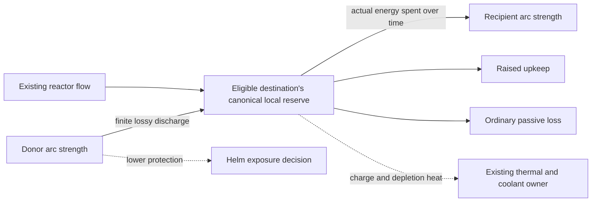

# Increment 9: shield energy and protection

This contract was adopted with its
[PASM decisions](../../../pasm/spec/design/shield-energy-and-protection.yaml)
before runtime changes, in `24947e0f`. Implementation is in progress; see the
[acceptance record](../../acceptance/1562-shield-energy.md) for verified results
and remaining work. Under the user's approved parallel-validation workflow,
increment 8 continues verification in a pinned worktree while main implements
this increment. Neither an initial commit nor this contract establishes a
completed playable exit.

## Selected design and scope

| Source | Requirement carried into this increment |
|---|---|
| [S022](../system-review.md#s022--shield-generators-and-directional-arcs) | Arc protection strength is separate from generator battery energy. Hits consume protection. Raised shields have continuous operating draw; recharging accounts for most shield-related consumption. Upkeep is additional to the ordinary fullness-dependent loss of a battery. |
| [S023](../system-review.md#s023--shield-focus--redistribution) | Discharge a donor arc into a battery, then recharge another arc from that reserve. Donor protection falls; recipient protection rebuilds over time. This is a physical conversion, not an instantaneous HP transfer or a free focus bonus. |
| [Local energy](../../../pasm/spec/design/local-energy-and-thermal.yaml) | Use the existing continuous local reserves, gross charge/depletion heat, actual finite coolant, intake limits, ordinary AI and recoverable incoming-flow cuts. A zero incoming allocation does not disable a charged System. |
| [S024 and G050](../system-review.md#s024--shield-modulation--frequency-retuning) | Every generator eventually supports timed defensive retuning while raised, with a temporary protection reduction and energy/heat cost. Optional probing and retuning remain increment 15 work. Shields in increment 9 must work independently of them. |
| [Reference crew and complexity](../README.md#selected-ship-system-directions) | Shield ownership is authored, not a hard-coded Station. The redesign's Cruiser reference puts protection on Science: simple delegates it, middle exposes defensive priorities, detailed exposes redistribution. Keep supported shipped hosts, visiting tabs and delegation journeys. |

The [catalogue](../ship-systems.md#protection-and-survivability) and
[proposal](../README.md) provide the wider activity context. Stored research
compares grouped recharge reserves with coupled power/thermal operation; it does
not establish Phoenix's shield upkeep or redistribution arithmetic. The
[historical Elite/EmptyEpsilon comparison](../README.md#research-comparison) is
inspiration, and the [Starsector comparison](../research/comparable-games-and-falling-frontier.md)
is explicitly only partially verified. Do not import a second flux/overload meter.

Armour, compartment damage and repairs stay with increments 10–11. Shield
probing, new frequency interactions and layered combat stay with 15; electronic
protection against jamming stays with 17. Remote shield/energy assistance (S094)
is not an implicit capability of an internal recovery connection.

## Starting point

At preparation revision `f6ba5d44`, the live owners are:

| Owner | Existing responsibility and migration consequence |
|---|---|
| [Gameplay ShieldSystem](../../../crates/phoenix-sim-gameplay/src/weapons/shield.rs) | Authored arc geometry/priority, integer strength and fractional regeneration, focus-derived limits, incoming-damage routing and collapse/recovery. Keep one strength/lifecycle authority per arc. |
| [Gameplay shield adapter](../../../crates/phoenix-sim-gameplay/src/ship/shields.rs) | Each arc's actual regeneration already spends its own local reserve through `work_continuous`. Empty/offline/full arcs do not recharge for free. This still lacks raised upkeep and redistribution. |
| [Energy state](../../../crates/phoenix-sim-gameplay/src/resources/energy.rs), [network](../../../crates/phoenix-sim-gameplay/src/resources/energy_network.rs), [Power wrapper](../../../crates/phoenix-sim-gameplay/src/modifiers/power_system.rs) | Canonical consumer reserves, accepted intake, work grants, thermal state, actual coolant accounting and saved controls. Do not add another shield battery to ShieldSystem. |
| [Authored shield config](../../../crates/phoenix-sim-gameplay/src/entities/config/shields.rs) | Arc parameters and existing focus/AI declarations. Every generated `shield-arc-*` System already has a stable owner and energy profile. |
| [Simulation shield owner](../../../crates/phoenix-simulation/src/ship/shields.rs), [AI host](../../../crates/phoenix-simulation/src/console_ai/server.rs) | Admission, ordinary human/AI focus controls, recent-damage observations, coordination, publication and reconnect. Reconcile the owning controller as the capability changes; never run competing old and new controllers. |
| [Snapshot](../../../crates/phoenix-simulation/src/snapshot/schema.rs) | Arc strength/fraction/offline/focus, ordinary AI history and Power continuation already persist. New intent or work progress must join these owners immediately. |

The old power allocation multipliers are not a shield-output contract. Existing
focus bonuses and penalties are authored migration inputs, not permission to
create strength or recovered energy by toggling focus.

## Reuse and ownership

**Adopted implementation choice [ai]: retain the current per-arc reserves and
stable System IDs.** Introduce validated, authored recovery destinations rather
than migrating to a shared generator battery. Default choices are the shield
arcs controlled by the same Console. Explicitly authored bindings must not
silently expand control authority or information access. Do not add a mandatory
central shield battery or replace the existing energy network.

A donor's admitted operation controls that donor. Its configured physical output
may charge an eligible destination's existing reserve; that does not issue a
command to the destination, change its raised/recharge intent, take over its AI,
or confer the destination Console's private observations. The recipient still
performs its own ordinary recharge work. Endpoint eligibility is immutable
content; selection/progress belongs to the donor's existing System continuation.

Use the generic capacity/intake/work/thermal machinery where its semantics fit.
Strength is a separate protection quantity, not a second EnergyState with copied
heat/coolant rules. Energy remains continuous; do not put it in integer Stock or
create an independent transfer simulator. Coolant keeps its actual service and
stock owner from increment 8.

## Physical work boundaries

### Raised operation and recovery

Represent requested raised state separately from effective operation, collapse
delay and thermal availability. Preserve that intent through flow cuts,
exhaustion, delegation, reconnect and thermal recovery. Shipped shields start in
their current raised state; the new operating control must not create a new seat
or require every player to configure shield automation before playing.

Spend raised upkeep for the actual operating interval, even at full strength.
Spend recharge energy only for actual strength rebuilt, bounded by the authored
recharge rate and remaining strength capacity. No upkeep/recharge draw occurs
merely because an idle or impossible action was attempted. Preserve the separate
general passive battery loss; it is not a substitute for shield upkeep.

**Adopted implementation choice [ai]: an affordable fraction of upkeep provides
partial effective protection.** At zero funding, lowering, thermal stop or an
applicable equipment condition, the field provides no interception. Retain
stored strength and raised intent; insufficient upkeep alone does not pretend a
hit destroyed that strength. Restoring operating energy can restore availability
of retained strength, but cannot refill strength already lost to damage or
discharge. Expose retained strength and effective protection separately.

The adopted implementation mapping uses the funded upkeep fraction for the same
fraction of interception; this is not a user-selected balance formula. It must
be deterministic and use the common damage-delivery split: protection that was
not actually provided leaks through normally. Test equivalent subdivided hits and fractional costs;
rounding must not grant free interception or destroy unrelated hull damage.

Retain authored arc geometry, priority, overlap rules, supported damage types
and shield pierce. The existing collapse delay followed by empty, rate-limited
recovery is the migration default. Upkeep shortage is distinct from collapse.
Do not reset collapse timers, erase damage or snap an exhausted/recovering arc
to full when energy returns. Damage, focus-derived decay and voluntary
discharge have distinct causes for observations and AI.

### Discharge into a battery

An explicit, bounded donor operation converts removed strength into energy
accepted by one eligible existing reserve. A destination at capacity, a missing
binding, thermal unavailability or a stopped donor cannot create energy or
remove strength for an unaccepted credit. Charge and discharge rates constrain
the actual conversion. Show the reason a requested operation is waiting.

Conversion is lossy. Authored recovered energy per unit of strength must not
exceed the source's energy cost to rebuild that unit; free recharge cannot be
converted into positive energy. Check all supported source operating modes,
including focus, rather than only a convenient base mode. The destination's
subsequent recharge cost and rate still apply. A full discharge/recharge cycle
cannot improve the total recoverable energy merely by alternating arcs, focus
or tick size. Numerical yield/rate values are provisional tuning.

For the initial authored schema, require positive recharge energy per strength;
allow zero upkeep for deliberately authored special equipment. Recovery is
disabled by zero yield or zero discharge rate. Positive recovery requires a
positive rate and a yield strictly below the donor's recharge cost and every
eligible recipient's recharge cost. The initial shipped bindings stay within
the controlling Console; generated base arcs use one parser tuning helper.

Commit strength removal and accepted destination charge together. If only part
fits or can run, commit only that corresponding part. Unaccepted strength stays
with the donor; rejected charge is not donated elsewhere. Fractional conversion
must be conserved and persist if it affects future work. Do not consume an
integer strength point then silently credit only a fractional remainder, or
credit energy against strength that was never removed.

Use the common EnergyState charge/depletion rules, with gross charge heat and
thermal trip on the receiving reserve. Incoming reactor flow retains its own
allocation/intake rules. A work-time recovery credit needs a transactional
accepted-charge entry point, like immediate work spending; do not call the whole
energy tick a second time and repeat passive loss, cooling or reactor generation.
An authored recovery throughput must not bypass the intended intake/capacity
limit. External intake and recovery share one canonical same-tick intake budget,
counting actual accepted energy; prove that the shared limit is enforced.

The recipient gains readiness only by spending its battery on its normal timed
recharge. Recovery energy can improve supply-limited recharge or sustain it
longer; it cannot exceed the equipment's authored recharge rate, manufacture
strength instantly, or replace Engineering's incoming-flow decisions.

## Human controls, ordinary AI and communication

Preserve the admitted `SystemId` boundary, current Console hosting, visiting,
ratings, human-seeking exceptions and per-System controller structure. Extend
the current shield surface with raised state, recharge priority and a bounded
donor/destination discharge operation. Reuse the existing focus choice where a
priority intent is equivalent; do not leave incompatible old focus and new
redistribution controllers both writing the same capability.

The ordinary individual System AI must operate every supported delegated action
through the same admission and physical constraints as a human. Migrate the
owning shield controller onto supported reusable state trees as part of the
capability change. Use closed observations/actions, authored thresholds, existing
cadence, deterministic last writes and private continuation. Workshop supplies
data, not expressions or new code. Co-hosted Console tabs do not pool knowledge;
no AI sees hidden attacker configuration or future hits.

Retain meaningful recent incoming-damage evidence. Existing net-HP sampling
must not label intentional donor discharge, focus decay, lowered operation or a
retune transition as incoming fire. Otherwise AI would focus the side it just
chose to drain. Adapt the existing damage-history producer to distinguish those
causes without adding a competing protection or AI-history authority.

Basic depth delegates routine protection while the human investigates and
communicates. Middle depth chooses meaningful defensive priorities. Detailed
depth exposes the full supported distribution controls. Depth changes access to
decisions, not efficiency or resource laws. Engineering prepares flow/cooling;
the protection operator reports endurance and weak sides; Helm chooses exposure
and recovery manoeuvres; Tactical creates or reports engagement windows. Keep
non-combat protection useful during hazards, towing, rescue and docking.

## Authored data and Workshop

Keep one source for each physical coefficient. Extend the accepted shield
definition with finite, validated upkeep, recharge energy per strength,
discharge throughput, recovery conversion and eligible battery bindings. Reuse
the local energy profile for reserve/intake/heat/coolant. Exact field names are
an implementation detail; do not retain the increment 8 normalized recharge
work cost as an additional competing cost after conversion.

Author conversion for every shipped arc/hull and supported fallback definition.
Preserve geometry, identity and scenario expectations. Initial tuning is marked
`[ai]`/provisional: choose a small nonzero upkeep and recharge-dominated operating
cost, then validate the resulting endurance and crew activity. No unreviewed
number from a research game becomes a Phoenix requirement.

Workshop must edit the supported coefficients and connections, validate them
before installation, and preserve document history, undo/redo, includes,
export/reload, Preview and disposable Test. Reject missing/foreign or ambiguous
destinations, incompatible resources, duplicate identities, unsupported modes,
non-finite/negative rates, invalid efficiencies, conflicting cost definitions
and conversion cycles that create energy. A binding adds no Station claim or
permission. Preview must show both protection and operating-resource effects.

## Local processing, replication and continuation

Keep Gameplay responsible for pure protection/conversion rules, the existing
EnergyState responsible for energy/thermal arithmetic and Simulation responsible
for joining the owners, authority and schedules. Model carries only supported
commands and projections; existing transport lanes and delivery classes remain.

The implementation specification must name a deterministic order for admitted
intent, upkeep, donor conversions, recipient recharge, incoming damage and
ordinary energy intake/cooling. Audit direct beams, bolts, torpedoes, collision,
regions and scripted damage. Shield service cannot protect a hit before the
required operating energy has been funded. A bounded physical transfer is not
a second AI controller or a second network simulation.

Persist raised/recharge/discharge intent, selected endpoint and any fractional
progress/effective protection needed to reproduce the next tick, alongside the
existing strength, collapse, focus, energy and AI continuation. Observation-only
fields remain projections. Validate complete identity sets, ranges, bindings and
conservation before restore; reject incompatible older content/state explicitly.
Handoff must retain System work and permitted Console views. A stale Console
host cannot change a shield, including discharge or working-view state.

The UI must distinguish strength, battery, upkeep/recharge demand, operating
fraction, cooldown and thermal state. Use the shared status/details widget and
existing Console summaries; preserve delegated-list visibility. Reconnect and
native Station displays receive the same permitted current projection as phones.

## Playable implementation slices

1. Specify and validate the new shield work-cost/binding data, converting current
   arc energy costs once. Preserve current controls and protection behaviour
   while establishing shared transactional conversion primitives with real tests.
2. Deliver paid raised operation and recharge together: human/AI controls,
   effective interception, shared status, Workshop and continuation. Keep current
   collapse/recovery and all shipped shield-bearing content operable.
3. Deliver donor discharge into eligible canonical reserves and ordinary timed
   recipient recharge, with conservation, endpoint feedback and delegated work.
   Remove superseded focus/cost adapters before increment 9 closes.
4. Integrate balance/activity, authority, authoring and continuation evidence on
   the complete changed capability. Structural preparation alone is not its exit.

No slice makes shields damageable without recovery or requires a later probe/EW
feature to make their ordinary controls usable.

## Verification and exit

- Pure work/conservation tests: full/partial/zero upkeep; full/offline/empty arcs;
  separate passive loss; headroom/rate/thermal limits; rejected charge; lossy
  donor cycles; fractional and subdivided steps; no self-generated damage reports.
- Actual damage consumers: correct geometry, pierce and down/up delivery splits;
  no free protection after an intake cut exhausts the local reserve; retained
  strength and restored operating energy remain distinct from replenished strength.
- Playable Cruiser demonstration: a charged arc survives an incoming-flow cut
  for its actual margin; depletion reduces operation; a donor sacrifices protection,
  credits an eligible reserve and enables visible timed recovery elsewhere.
  Repeat through ordinary AI and across human takeover/delegation/reconnect.
- Shipped hulls and scenario journeys: load every supported definition; exercise
  conventional and unusual arcs, overlapping geometry and 2/4/6/8-seat hosting.
  Check combat and a non-combat protection task. Record changes in balance and
  workload rather than claiming structural equivalence for intentional new costs.
- Snapshot/digest/multiplayer continuation: capture during collapse, partial
  upkeep, fractional discharge, destination saturation and thermal trip; compare
  resumed execution and reject stale-host and malformed state before any mutation.
- Workshop and clients: edit/undo/reload/validate/Preview/Test; author a supported
  asymmetric protection loadout; inspect exact permitted status on phone/browser
  and native Station surfaces. Record physical/human acceptance separately.

Use targeted owner checks during implementation, independent read-only review
and the repository's required integrated gates once before a push. Keep expensive
Cargo/performance checks sequential. Record the tested revision and limitations;
do not update the ledger to a passed increment on document preparation alone.

## Adopted implementation specification choices

The design interview left these arithmetic and timing details open. The following
integration judgments are adopted for implementation [ai]; they still need the
runtime traces and authored evidence above, rather than another design interview.

| Choice | Adopted implementation [ai] |
|---|---|
| Upkeep and recharge | Pay upkeep before recharge in stable arc order. Establish the actual schedule edges to incoming-damage consumers so each uses the same funded operating interval. |
| Partial protection | The affordable upkeep fraction permits that fraction of interception. The remainder bypasses protection normally. Only intercepted damage consumes stored strength; use persisted fractional accounting and test equivalent subdivided hits. |
| Recovery operation | A selected eligible target is persistent discharge intent until cancellation. Execute bounded per-second conversion in stable order. Remove only strength whose energy is actually accepted; full, thermally stopped or intake-limited recipients do not discard donor strength. |
| Combined intake limits | Reactor delivery and recovered energy share the canonical per-tick maximum-intake budget, charged by actually accepted energy rather than requested energy. A work-time charge cannot reset or double that budget. |
| Lowered operation and voluntary emptying | Raised intent defaults true; lowering preserves stored strength. Voluntary discharge to zero starts no special collapse timer; incoming damage retains ordinary collapse. Lowered latent recharge must still be specified explicitly if offered. |
| Initial AI policy | Preserve current evidence-based focus as the initial recipient priority, add supported raised/recharge/discharge intents and authored safe donor criteria. A policy that only executes requested discharge is simpler; autonomous donor selection needs visible local evidence and tested safety thresholds. No omniscient shield manager. |
| Tuning | Upkeep/recharge ratio, discharge rate, conversion loss, intent limits and AI thresholds remain authored provisional values. Retuning duration/reduction and probe interactions are later work, not required numbers here. |
