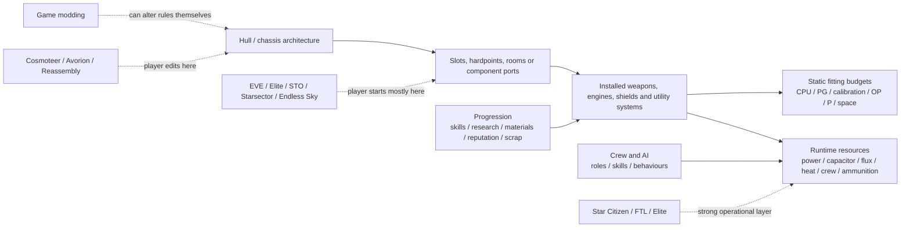

# Functional Ship Customisation in Space Games

## Executive summary

**Research cut-off: 17 August 2026.** This report compares functional rather than cosmetic ship customisation: installed hardware, hardpoints, power and energy management, internal systems, crew and AI configuration, performance tuning, construction geometry, fitting budgets, progression gates and gameplay-affecting mod support. Cosmetic skins, paints and purely visual ship-part swaps are excluded.

The most important finding is that “ship customisation” describes **four substantially different design models**, and games that appear similar at first glance often give the player agency over completely different layers:

1. **Fitting-puzzle games** make the hull immutable but provide a rich optimisation problem inside fixed slots and budgets. **EVE Online** is the clearest example: high/mid/low/rig slots, weapon hardpoints, CPU, powergrid, calibration, skills and drone capacity all constrain a fit simultaneously. **Starsector** reaches a similarly interesting result with one shared Ordnance Point budget spanning weapons, hullmods and flux capacity/dissipation. **Elite Dangerous**, **Star Trek Online** and **Endless Sky** also belong broadly to this family, although their budget structures differ substantially. EVE's current fitting UI explicitly exposes slot, hardpoint and resource limits, and CCP continues to balance hulls by changing hardpoints, CPU and powergrid; Starsector directly prices weapons, fighters, hullmods and flux improvements in OP. citeturn24search0turn24search2turn32search0turn32search19

2. **Component/equipment-platform games** preserve a highly authored physical hull and let players replace equipment that the hull was engineered to accept. **Star Citizen** is the strongest example: itemports restrict components by both **type and size**, while its newer resource-network/engineering layer adds operational ship-system management. **X4: Foundations** follows a less simulation-heavy version of the pattern: engines, shields, thrusters, weapons, turrets and software are fitted to hull-defined equipment positions, while crew quality and persistent AI behaviours add another major customisation axis. citeturn23search4turn22search1turn26search0

3. **Ship-as-architecture games** expose geometry itself as a functional variable. **Cosmoteer** gives the greatest direct control over internal architecture: the player lays out rooms, corridors, weapons, engines and crew accommodation, and crew physically move power and ammunition through that plan. **Avorion** offers extreme three-dimensional geometric freedom through arbitrarily scaled blocks and explicitly has no fixed maximum ship size, though materials, processing power, subsystem sockets, resources and practical performance become the constraints. **Reassembly** reduces the same idea to a fast 2D modular construction language governed by block geometry, mass, power and a point budget. citeturn29search2turn31search0turn31search2turn30search3

4. **Run-based system optimisation** is represented especially well by **FTL: Faster Than Light**. Instead of designing a new hull, the player gradually turns a fixed room plan into a combat machine under reactor-power, system-slot, weapon/drone-slot, crew and scrap constraints. Its fitting choices are unusually consequential because almost all of them disappear when the run ends. citeturn29search1turn29search19

Among the five specifically requested large titles, **EVE has the deepest pure fitting-budget problem; Elite the strongest interaction between conventional outfitting, mass, power and permanently engineered module statistics; STO the widest set of orthogonal “build layers” despite a rigid hull; Star Citizen the strongest physical-component and operational-engineering direction; and X4 the strongest crew/AI/fleet-behaviour customisation**. citeturn24search0turn19search1turn21search0turn22search1turn26search0

The indie field changes the design space much more radically. **Cosmoteer is the standout if “internal layout” really means internal layout**, rather than equipping a predefined internal slot. **Avorion** is strongest for arbitrary scale and 3D block construction. **Starsector** is perhaps the cleanest small-studio example of a tightly constrained combat fitting puzzle. **Endless Sky** is particularly instructive because its three overlapping space budgets—general outfit space, weapon capacity and engine capacity—prevent apparently logical but balance-breaking substitutions. **Reassembly** combines geometry and AI flags with an arcade-like point economy. **FTL** demonstrates how a comparatively narrow customisation system becomes deep when every upgrade competes with survival resources inside a permadeath run. citeturn29search2turn31search0turn32search0turn30search6turn30search3turn29search1

A final cross-cutting finding concerns game modding. The sandbox/single-player titles—especially **X4, Cosmoteer, Starsector, Endless Sky and Reassembly**—deliberately expose mod ecosystems. The always-online games generally do not. EVE is the interesting exception in spirit: rather than allowing client gameplay mods, CCP exposes an official REST API and fitting data formats that enable an unusually sophisticated ecosystem of external fitting and analysis tools. Star Citizen currently has the opposite security model: its Easy Anti-Cheat documentation says altered game files are generally blocked, although CIG has discussed a possible future approval/whitelisting programme. citeturn26search6turn29search2turn32search1turn30search3turn24search12turn24search16turn32search21

## Comparative framework and table

For this comparison, an **exact constraint** means the actual rule visible to the player—“this hull has N slots of these classes”, “the itemport accepts this component type and size”, “this fit must remain under CPU and powergrid”, “these modules share OP”, or “the ship has only this much weapon capacity”—rather than a general statement such as “bigger equipment is expensive”. Where values vary by individual hull, it would be misleading to give a single numeric limit. Universal or near-universal limits are called out where useful, such as FTL's system-space model and Avorion's subsystem-socket ceiling. citeturn24search2turn29search1turn31search2

**Budget** below means a *fit-time* resource such as CPU, powergrid, OP, P or outfit capacity. It is distinct from a *run-time* resource such as EVE capacitor, Elite's distributor reserves, FTL reactor power or Star Citizen's resource network. That distinction matters: two designs can be equally legal to fit yet behave very differently under sustained combat load.

| Game | Functional model and systems | Principal hard constraints | Main budgets / dynamic constraints | Persistence | Game modding / community tooling |
|---|---|---|---|---|---|
| **Star Trek Online** | Fixed starship chassis; fore/aft weapons, deflector, engines, core, shields, devices, Eng/Sci/Tac/universal consoles, bridge-officer abilities, traits, specialist seating, some hangars/experimental weapons, subsystem-power tuning | Hull fixes weapon counts, console/device slots and Bridge Officer seat career/rank/specialisation; some equipment/console/trait restrictions; upgrade tokens add prescribed extra slots rather than redesigning the hull | No EVE-style CPU/PG budget; build is constrained mostly by slots, exclusivity and progression; weapons/shields/engines/auxiliary have operational subsystem power | Persistent character/ship build | No supported functional client-mod framework apparent in the live MMO; external build and combat-analysis tools instead. citeturn21search0turn21search1turn21search9 |
| **Star Citizen** | Fixed physical hull with replaceable component itemports; weapons/turrets/missiles, power plants, cooling, shields, quantum drive, radar and other systems; engineering/resource-network management | Item must match an itemport's **allowed type and size**; ports and physical locations remain hull-defined | Power/resource availability and damage/engineering state increasingly matter at run time; equipment must fit hull's component architecture | Persistent within the live Alpha persistence regime; current vehicle-loadout snapshots aid item recovery, but this is not release-MMO permanence | Functional file modification is generally blocked by EAC; CIG has explored possible approved mods. citeturn23search4turn22search1turn23search1turn32search21 |
| **Elite Dangerous** | Fixed hull; hardpoints, utility mounts, core internals, optional internals; weapons, power plant, thrusters, FSD, distributor, sensors, shields, cargo/mining/exploration/hangar modules; extensive Engineering | Hull fixes number/class of slots and hardpoints; module class/compatibility; some modules have mass/hull requirements; Engineer/technology unlocks | Power-plant output, module priorities, distributor SYS/ENG/WEP reserves, mass, thermal load; Engineering changes statistics with explicit trade-offs | Persistent; engineering is attached to modules | No supported functional gameplay-mod ecosystem; strong external planners/databases such as EDSY, Coriolis and Inara. citeturn28search0turn19search1turn28search5turn28search10 |
| **EVE Online** | Fixed hull; high/mid/low slots, rigs, turret/launcher hardpoints, drones/fighters, ammo, propulsion, tank, EWAR, logistics, mining and utility modules | Hull slot layout; turret/launcher count; module size/type; skills; drone bandwidth/bay; ship-specific bonuses/restrictions | **CPU + powergrid + rig calibration** are primary static budgets; capacitor is a run-time resource | Persistent until refitted/destroyed; fits can be saved/simulated | No client gameplay mods, but exceptionally strong official **ESI/SDE/fitting formats** and community fitting ecosystem. citeturn24search0turn24search3turn24search12turn24search16 |
| **X4: Foundations** | Hull-defined engines, shields, thrusters, weapons, turrets and software plus crew composition, captain skill and AI/default behaviours; crafted equipment modifications | Hull size/role and fixed equipment locations determine what can be installed; finite crew accommodation; behaviour availability depends partly on captain skill; modification progression/materials | No universal CPU/PG-like fit budget; constraints are slots, compatibility, price/supply, crew and progression | Persistent savegame/fleet configuration | Excellent: official extension architecture, Workshop support, X Catalog Tool and asset tools. citeturn26search0turn26search1turn26search6 |
| **FTL: Faster Than Light** | Fixed room layout upgraded during a roguelike run; reactor, weapons, shields, engines, drones, cloak, hacking, teleporter, mind control, med/clone systems, augments, crew | Player ships have **8 system slots and 4 subsystem slots**; hull-specific weapon/drone slots; mutually exclusive alternatives such as medbay/clone bay; crew cap and system maximum levels | Reactor power, weapon/drone power, scrap, ammunition/drone parts and store RNG | **Session/run-based**; ship/layout unlocks meta-persist | Strong unofficial mod scene through the Subset community; not an official in-game mod API. citeturn29search1turn29search19turn29search12 |
| **Cosmoteer** | **Player-designed floorplan**: structure, corridors, armour, weapons, engines, reactors, storage, crew rooms and logistics; custom crew roles/job priorities | Physical module footprints, adjacency/access, firing arcs, crew travel routes, resource delivery and destruction of individual modules | Crew labour/time, power and ammunition logistics, materials/economy; mass/thrust emerges from actual design | Persistent career ships/blueprints; PvP configurations are match-contextual | First-class mod framework and Steam Workshop; designs are directly shareable. citeturn29search2turn29search5 |
| **Avorion** | Free 3D block construction; engines/thrusters, generators/batteries, armour/hull, shields, cargo, hangars, hyperspace systems, turret platforms and subsystem upgrades | Material/progression restrictions and block/resource cost; processing power gates subsystem sockets, to **15 maximum** | Energy, crew, mass/mobility, processing power and resources; no geometric maximum ship size | Persistent sandbox ships and saved designs | Workshop design sharing and a substantial community-mod ecosystem. citeturn31search0turn31search1turn31search2turn30search0 |
| **Starsector** | Fixed hull/mount geometry; weapons, fighter wings, hullmods, flux vents/capacitors and officer configuration | Weapon mount type/size, fighter-bay count, mutually incompatible hullmods, hull-specific vent/cap limits and built-ins | **Ordnance Points** are shared by weapons, hullmods, fighters and flux improvements; combat **flux** is the key run-time budget | Persistent campaign fittings | Very strong official-forum mod ecosystem; documentation/resources for current 0.98a. citeturn32search0turn32search19turn32search1 |
| **Endless Sky** | Fixed hull with outfits: weapons, engines, generators, batteries, cooling, shields/repair, fuel, cargo, bunks, scanners and special equipment | Fixed gun/turret hardpoints plus three capacities: general outfit space, weapon capacity and engine capacity | Space, energy generation/storage, heat, mass, fuel and crew requirements | Persistent campaign | Open-source; plugins can define new ships, outfits and mechanics, with documented creation tools. citeturn30search6turn30search2turn30search10 |
| **Reassembly** | Free-form 2D blocks: armour, generators, thrusters, shields, guns/missiles, command, storage/factories/drones depending on faction; AI flags | Block attachment/geometry; faction palette; unlocked block set; point cost | **P** construction budget, generator output, mass/inertia/thrust and geometry | Persistent designs/progression; individual combat contexts are arcade-like | Excellent plain-text/data-driven mod system; mods may override/extend packaged data and AI flags are exposed. citeturn30search3turn30search25 |

A useful way to understand the systems is as a sequence of nested restrictions. Games differ primarily in **how far to the left the player is allowed to edit**:

In other words, **a game does not necessarily have “more customisation” just because it has more equipment items**. Cosmoteer may have fewer named equipment tiers than a long-running MMO, yet changing a corridor's position can alter weapon throughput, crew travel time, survivability and power delivery simultaneously. Conversely, EVE keeps hull geometry entirely immutable but extracts extraordinary depth from tightly coupled mathematical constraints. citeturn29search2turn24search0turn24search2

## Major online and persistent-universe games

**Star Trek Online — layered buildcraft on a rigid chassis.** STO's starships are essentially highly parameterised character classes. A hull publishes a fixed number of fore and aft weapon slots, device slots, Tactical/Engineering/Science console slots, Bridge Officer stations with explicit rank/career/specialisation, manoeuvring statistics and subsystem-power modifiers. Tier-6 mastery adds another layer because reaching the relevant mastery level unlocks a starship trait that can subsequently be slotted into trait builds. Experimental Ship Upgrade tokens can extend a T5-U/T6 ship with prescribed additional device, universal-console and trait capacity, but they do not let the player turn a cruiser into an escort-style hardpoint layout or redesign its Bridge Officer seating. citeturn21search0turn21search1turn21search12

**Customisable systems.** Functionally relevant equipment includes fore/aft energy and projectile/torpedo weapons; deflectors; impulse engines; warp or singularity cores; shield arrays; devices; Engineering, Science, Tactical and Universal consoles; Bridge Officer ability choices; specialist seating; starship traits; and, on eligible hulls, hangars and experimental weapons. Cryptic's R&D documentation explicitly includes Engineering consoles, impulse engines and warp/singularity cores among craftable starship equipment, while reputation systems supply specialised shields, cores and related sets. citeturn21search31turn21search3turn21search25

**Limits.** The decisive constraints are *categorical rather than volumetric*: fixed slot counts, console categories, Bridge Officer career/rank/specialisation, equipment restrictions, equip limits on some unique items and progression/access to gear or traits. There is no EVE-like ship-wide CPU/powergrid budget preventing a legal item from being slotted. Power is instead an operational performance variable across the weapon, shield, engine and auxiliary subsystems; current 2026 equipment still modifies both current and maximum subsystem output. citeturn21search0turn21search9turn21search24

**Typical builds.** The system naturally produces beam-array broadside cruisers with tactical firing modes and energy consoles; forward cannon escorts; torpedo-focused kinetic ships; science vessels built around control/exotic-damage Bridge Officer powers and auxiliary power; carriers that amplify hangar pets; and high-durability tank/support cruisers. These archetypes are best understood as combinations of gear, console, Bridge Officer and trait layers rather than modifications of the physical ship itself. citeturn21search0turn21search18turn21search24

**Persistence and tools.** Builds persist with the character and ship until changed. STO's live-service architecture does not expose a supported functional client-mod framework comparable with X4 or Starsector; community activity therefore concentrates on external build planning, combat-log analysis and databases. That last point is an inference from the live game's supported systems rather than an explicit Cryptic “no mods” design statement.

**Star Citizen — component compatibility plus increasingly important operational engineering.** Star Citizen occupies an unusual middle ground. Its ships are highly authored physical objects with real interiors and component locations, but the player generally customises *equipment installed into the authored ship*, not the ship's architecture. CIG's itemport design rule is unusually explicit: an item can mount only where **both its type and size match the itemport's permitted type and size**; the same architecture covers weapons, turrets, thrusters, power plants, tanks, scanners, cooling equipment and other ship items. citeturn23search4turn23search0

**Customisable systems.** The component model encompasses weapon and turret hardpoints, missiles/ordnance, power plants, coolers, shield generators, quantum drives, radar/scanning and other ship equipment, with ship-specific combinations and sizes. This is a more restrictive compatibility model than EVE's generic slot categories: changing a shield does not mean that the same physical position can become a cooler or that several small ports may simply be pooled into one larger port. citeturn23search0turn23search4

The second layer is the newer **Resource Network and Engineering** model. Alpha 4.5.0, released in December 2025, introduced ship engineering terminals intended to provide oversight of ship systems and their network. Alpha 4.9 became available on live servers on 15 July 2026, so this report treats the engineering layer as part of the current live Alpha rather than a purely speculative roadmap feature. citeturn22search1turn22search8

**Limits.** Hull identity remains dominant: itemport type, itemport size, number/location of weapon or component mounts, turret architecture, cargo/interior architecture and physical ship dimensions are not freely reallocatable. The runtime resource network adds another class of trade-off: installed components must actually be supplied and managed as functioning ship systems, and damage can turn engineering state into a tactical concern. This creates a notable distinction between “a legal loadout” and “a ship whose systems remain healthy and adequately supplied during combat”. citeturn22search1turn23search2

**Typical builds.** A fighter might exchange weapon packages and shields for a particular combat envelope; a longer-range ship can prioritise quantum-drive performance and defensive reliability; a multicrew combat vessel can favour component redundancy and power-management headroom. The defining limitation is that these are **refits of the manufacturer's ship**, not player-designed vessels.

**Persistence and modding.** Vehicle configurations are persistent within Star Citizen's live-Alpha persistence system rather than permanently guaranteed in the released-MMO sense. Alpha 4.8.3 added Vehicle Loadout snapshots at ASOP terminals to support item recovery, showing that CIG now explicitly persists/restores loadout state as a gameplay system. Functional game-file modification is not currently a supported extension route: CIG's June 2026 Easy Anti-Cheat guidance states that EAC blocks most altered files, while noting only that the company is exploring what a future approval/whitelisting scheme *might* look like. citeturn23search1turn32search21

**Elite Dangerous — slot fitting transformed by permanent statistical engineering.** Elite begins with a conventional fixed-hull outfitting model: hardpoints and utility mounts sit alongside mandatory core internals and flexible optional internal bays. Core equipment includes such fundamental systems as power generation, propulsion, Frame Shift Drive and power distribution; optional spaces enable defence, cargo, exploration, mining, passenger, vehicle and fighter functionality. The individual hull determines how many slots exist and the maximum class each one accepts. citeturn28search0

What makes Elite distinctive is that **Engineering mutates the statistics of the modules themselves** rather than merely choosing among stock equipment. Frontier's current Operations material still frames modules as being bought at base level through Outfitting and upgraded using Engineer blueprints. A representative current blueprint such as Increased Range FSD illustrates the underlying model: additional optimised mass/jump capability comes with explicit changes to power draw, integrity and module mass, while experimental effects can add another targeted property. citeturn19search1turn28search5

**Customisable systems.** Weapons and mining tools occupy hardpoints; defensive/scanning utilities use utility mounts; the core set covers power plant, thrusters, FSD, life support, power distributor, sensors and fuel; optional internals cover shields, cargo racks, fuel scoops, collector/prospector systems, module/hull reinforcement, repair equipment, passenger cabins and vehicle/fighter functionality, among others. Engineering can retune many of these, making flight behaviour, heat, mass, jump range, resistances, weapon characteristics and power consumption part of the build problem. citeturn28search0turn28search5

**Limits.** First come hull-defined slot number and size. Second are individual-module compatibility constraints. Third is power: a ship's power plant must support active equipment, and power priorities decide what shuts down first when available output becomes insufficient. Fourth is the distributor's moment-to-moment allocation to systems, engines and weapons. Fifth is **mass**—central to acceleration, jump performance and various module operating envelopes. Finally, the strongest modifications are gated by access to Engineers, reputation/progression and materials. citeturn18search4turn19search1turn28search5

That layering makes an Elite “flight-model build” unusually meaningful without exposing literal flight-control parameters. A lightweight engineered explorer, a heavy shield tank and an aggressively engineered combat ship can have markedly different acceleration, boost, heat and jump characteristics even when based on the same chassis.

**Typical builds.** Representative archetypes are a stripped-down long-range explorer with engineered FSD and lightweight support equipment; an armoured or shield-heavy combat ship with engineered weapons and distributor; an anti-xeno specialist; a mining ship whose hardpoints and optional slots are largely industrial; or a cargo vessel trading defences for internal capacity. External tools such as EDSY and Coriolis model the resulting coupled mass, power and engineering problem, while Inara tracks unlocks, equipment and materials. citeturn28search10turn28search12

**Persistence and modding.** Installed and engineered modules persist and can be moved/stored rather than resetting per play session. Elite does not expose a supported functional game-mod framework comparable with X4; the practical customisation ecosystem is therefore external planners, journals/databases and companion utilities rather than changing the simulation rules.

**EVE Online — the strongest multi-budget fitting system in the comparison.** EVE's hull is immutable but its fitting puzzle is exceptionally dense. The official fitting window exposes high, medium and low slots plus rig positions, weapon hardpoint counters and ship resources; the fitting simulator can reproduce a fit without owning the hardware and save it until the required modules and skills are acquired. citeturn24search0turn24search3

**Customisable systems.** High slots contain turrets, launchers and utility/high-slot equipment; mid slots commonly cover propulsion, shields, capacitor, electronic warfare and tackle; low slots include armour, damage, fitting and mobility modules; rigs provide more permanent ship modifications. Drones/fighters, charges/ammunition and subsystem categories on applicable hulls add further layers. CCP's fitting interchange format explicitly serialises low, medium and high modules, rigs, subsystems, drones/fighters, charges and cargo. citeturn24search24

**Limits.** A hull has an exact high/mid/low/rig layout and exact turret and launcher hardpoint counts. Installed modules then consume two independent ship-wide fitting resources—**CPU and powergrid**—while rigs consume **calibration**. Drone-oriented hulls add drone-bay and bandwidth constraints, and item/ship use is affected by character skills. CCP still balances ships by changing these exact numbers: the June 2026 Cradle of War notes, for example, increased the Maulus Navy Issue from two to three turret hardpoints and simultaneously raised its powergrid from 38 to 40 and CPU from 150 to 155 specifically to accommodate the extra fitting opportunity. citeturn24search2turn24search9

A particularly revealing 2025 balance change added high slots to two ships **without** increasing CPU or powergrid; CCP explicitly noted that new modules would therefore still have to fit inside existing fitting constraints. This illustrates why “slot count” alone badly understates EVE's design: a free physical slot is not necessarily a fit-able slot. citeturn24search17

Capacitor forms a different, operational budget: a fit can satisfy CPU and powergrid perfectly yet be unable to sustain propulsion, repair, shield boosting, electronic warfare or capacitor-hungry weapons indefinitely. Ship bonuses, skills and module interactions therefore determine both *legal fit* and *sustainable combat state*.

**Typical builds.** Missile/shield kiting, armour brawling, electronic-warfare support, logistics, exploration/scanning, mining, active-tank and buffer-tank fits are all produced by the same fixed-slot language. Even mining illustrates the hull constraint: CCP's own mining guidance notes that miners can be fitted to suitable turret hardpoints, while specialised ORE hulls differentiate themselves with bonuses and dedicated holds. citeturn24search23

**Persistence and ecosystem.** Fits persist on physical ships and can be saved, shared and simulated. Rather than client gameplay mods, CCP publishes the official **ESI** REST interface, Static Data Export and established fitting formats; CCP's own developer site catalogues community applications including tools that browse and share fittings. This is arguably the richest *external* ship-customisation ecosystem in the sample even though the running client itself is not moddable. citeturn24search12turn24search16

**X4: Foundations — equipment fitting plus crew and persistent autonomous behaviour.** X4's ship customisation becomes particularly interesting when “ship system” is defined more broadly than hardware. Its hulls accept engines, shields, software, thrusters, weapons and turrets, but ships can also be populated with Captains, Service Crew and Marines. Each ship has finite personnel accommodation; captain quality affects how well the ship performs and can unlock additional standard behaviours, while service crew improve areas including control, aiming, trading and repair. citeturn26search0

**Customisable systems.** Hardware includes engines, shields, thrusters, forward weapons, autonomous turrets and software. Weapon slots and turret locations are authored into the hull, and eligibility is constrained by ship role/size rather than by a universal free-form hardpoint system. On top of installed hardware, X4 exposes **orders and AI behaviour**, so the same hull can be made functionally different as an interceptor, escort, trader, miner, patrol vessel or fleet subordinate through persistent automation. citeturn8search24turn8search9turn26search0

Vanilla ship modifications add another statistics layer to chassis, engines, shields and weapons/turrets and are tied to research/material acquisition; this should not be confused with game modding. citeturn26search19turn26search24

**Limits.** X4 does not present the player with a single abstract fitting budget comparable with EVE CPU/PG or Starsector OP. The decisive hard limits are the ship model's equipment locations, compatible size/class and role, plus finite crew capacity. Economic supply, faction availability and modification research/materials operate as progression/economy limits. Vanilla also does **not** let the player rearrange the vessel's internal floorplan or move surface-element positions: those remain properties of the authored hull.

**Typical builds.** An S/M combat craft might prioritise high-performance engines, shields and forward weapons; a destroyer can be tuned around anti-capital main guns versus anti-fighter turret coverage; a freighter can emphasise engines and defensive turrets while its high-skill captain executes autonomous trade; a carrier's effectiveness depends on both fitted systems and its fleet/crew arrangement. That combination of equipment and behaviour makes X4 more interesting as a **fleet-design system** than as a pure fitting spreadsheet.

**Persistence and modding.** Ship equipment, crew assignments and AI orders are persistent savegame state. X4 is one of the most mod-friendly titles here: Egosoft documents extensions, supplies the X Catalog Tool needed to extract/compile `.cat`/`.dat` content, provides asset tooling and supports Steam Workshop distribution. Functional modifications can therefore alter not only individual player ships but the definitions of ships, equipment, AI, missions and wider game systems. citeturn26search1turn26search4turn26search6

## Indie and small-studio selection

The six selected titles are **FTL: Faster Than Light, Cosmoteer, Avorion, Starsector, Endless Sky and Reassembly**. Together they cover a roguelike, physical ship-layout simulation, 3D block sandbox, tactical fleet RPG, open-source space sandbox and arcade-style modular constructor. Cosmoteer additionally satisfies the requested **sandbox/RTS hybrid** criterion through its procedurally generated career mode and real-time command of individual ships or fleets; FTL satisfies the requested roguelike/run-based category. citeturn29search2turn9search15

**FTL: Faster Than Light — bounded system composition under permadeath pressure.** The player's selected hull comes with a fixed room plan and starting equipment; the run then consists largely of deciding what to buy, install, upgrade, power, repair and crew. All player ships have eight system spaces and four subsystem spaces, which means the game deliberately prevents a final ship from simply possessing every major system. Weapon and drone capacity is also hull-specific. citeturn29search1turn29search13

The customisable systems include reactor output, shields, engines, weapon control, drone control, oxygen, medbay or clone bay, cloaking, teleportation, hacking, mind control and backup battery depending on hull/run availability, plus piloting, doors and sensors, weapons, drone schematics, augmentations and crew. Crew members themselves function like mobile subsystem modifiers: location, species abilities and accumulated skills influence system effectiveness, boarding and repairs. Player ships can normally carry up to eight crew. citeturn29search1turn29search19

The constraints are unusually clean: system-space cap; hull-fixed weapon/drone slot counts; maximum upgrade levels; reactor-power consumption; mutually exclusive alternatives such as medbay versus clone bay; finite crew; ammunition/drone-part consumables; and, above all, **scrap opportunity cost**. A point spent adding reactor capacity may mean not adding a shield layer or weapon-control level before the next sector. Store availability and random rewards turn compatibility into a probabilistic progression gate.

Typical endgame strategies include laser/flak volleys designed to remove shield layers before a beam fires; missile-assisted shield bypass; boarding builds centred on teleporter/crew; drone-heavy builds; and cloak-based “survive the enemy volley, then fire synchronously” designs. These are **session-based fits**: the developed ship is lost at death or completion, while unlocked hulls/layouts survive as metaprogression.

FTL has a large unofficial modding tradition rather than a formal first-party API; Subset's own community forum contains dedicated discussion and distribution of functional system mods and tools. citeturn29search12turn29search14

**Cosmoteer: Starship Architect & Commander — the strongest internal-layout customisation in the sample.** Cosmoteer's own description is unusually literal: the player customises the ship's **shape and floor plan**, choosing where to place weapons, engines, hallways and crew quarters. Crew are individually simulated, operate weapons and physically carry munitions; players may override their autonomous logistics with specific roles and job priorities. Individual modules can be targeted and destroyed, and ships can physically break apart. citeturn29search2

That turns “internal layout” from a menu abstraction into a systems-engineering problem. Armour, walls, corridors, doors, power production, storage, crew accommodation, engines/thrusters, shields, weapons, ammunition/factories and logistics form a graph. Moving a reactor closer to a weapon may improve supply time but also create a catastrophic single point of failure. Adding armour improves survivability while increasing material and mobility costs. Long corridors consume crew time. Weapon placement affects arcs and exposure. A “module slot” is therefore simultaneously a geometric, logistical and vulnerability decision. citeturn29search2turn29search5

The exact constraints are mostly **physical rather than abstract**: parts occupy finite tiles; rooms need usable access; crew have finite travel time; power/ammunition must reach consumers; weapons need viable arcs; engines create thrust on a ship with actual mass and geometry; and Career mode forces designs through economic/progression resources. Unlike EVE, there is no reason for every optimal ship to consume exactly the same abstract CPU number—the inefficiency of the physical design *is* the constraint.

Typical designs include long-range rail/beam kites, missile barges with protected ammunition logistics, heavily armoured close-range gunships, ion-beam ships whose internal power/logistics are designed around their emitter network, and specialised fleet vessels rather than self-sufficient generalists.

Career ships and saved designs persist; competitive modes use chosen designs in match contexts. Mod support is first-class: the official site advertises a powerful modding framework and Steam Workshop, while the official wiki documents mod installation/development. citeturn29search2turn9search6

**Avorion — arbitrary scale, functional volume and subsystem-socket progression.** Avorion lets the player build a genuinely three-dimensional ship from functional blocks. Its official site states that blocks can be scaled arbitrarily and that ships have **no maximum size limit**; seven materials have different properties and dozens of block types support player-designed ships. citeturn31search0

The functional palette includes structural hull/armour, engines and directional control, generators and energy storage, shields, cargo and crew capacity, hangars, hyperspace-related systems, docks and turret installations, with subsystem upgrades adding further specialised capabilities. Because functional blocks have volume and the entire resulting construction has mass, putting more of “everything” into the ship is possible in principle but increasingly expensive, heavy and demanding.

Avorion's especially important abstract limit is **Processing Power**. Except for the first subsystem socket, additional subsystem sockets require processing-power thresholds, with a maximum of **15 sockets**. This prevents unlimited block volume from translating directly into unlimited upgrade modules. citeturn31search1turn31search2

Thus Avorion's constraint stack is: material/progression availability → physical block volume and resource cost → energy/crew/mass consequences → processing power → subsystem-socket count → available turrets/equipment. The remarkable “no maximum size” rule therefore means *no arbitrary geometric ceiling*, not “no gameplay limits”. Resources, movement, crew, power and computational/performance practicality remain powerful soft constraints. citeturn31search0turn31search2

Typical builds range from highly shielded artillery battleships through carrier/hangar ships and torpedo craft to mining, salvage and cargo vessels. Designs and ships persist in the sandbox campaign. Steam Workshop directly supports sharing ship and station constructions; the wider ecosystem also includes game-content/script mods. citeturn31search0turn30search0

**Starsector — fixed-hull fitting with a brilliantly unified OP/flux trade-off.** Starsector's refit screen lets the player change modular weapons, hullmods, flux capacitors and flux vents. The crucial design decision is that these all compete for **Ordnance Points**: Fractal Softworks' own design documentation describes spending OP not only on weapons but on additional vents to improve dissipation and capacitors to increase maximum flux, while fighter LPCs on carriers likewise cost OP. citeturn32search0turn32search19

Customisation covers weapons mounted into fixed small/medium/large and typed mounts, fighter wings on carriers, hullmods, capacitors and vents; officers and hull-specific built-in systems add another behavioural layer, but a ship's signature active “ship system” is generally part of the hull rather than a replaceable module. Current 0.98a documentation describes the same fundamental refit model. citeturn30search13turn30search27

The hard constraints are mount **type and size**, number of fighter bays, hullmod incompatibilities and hull-specific maxima. OP then forces every desirable subsystem to compete with every other. This interacts with **flux**, Starsector's central run-time combat economy: weapons and shields generate flux, dissipation removes it, and overload creates vulnerability. Consequently a “maximum DPS” weapon fit may be tactically worse than a lower-paper-DPS configuration that reserves enough OP for vents and hullmods to maintain flux control.

Typical builds include low-tech armour brawlers with ballistic batteries; high-tech fast ships spending heavily on shields and flux management; missile strike craft; dedicated carriers; long-range beam/kiting ships; and phase-ship strike builds. Most of the interest comes from adapting a fixed hull's strengths rather than deleting its weaknesses.

Fits persist throughout the campaign until changed or the ship is lost. Starsector also has one of the strongest small-game mod communities: Fractal Softworks maintains dedicated modding forums, guides and work-in-progress official documentation, with the current forum ecosystem targeting 0.98a. citeturn32search1turn32search29

**Endless Sky — three overlapping capacity budgets rather than one generic “space” number.** Endless Sky's player manual explains the design especially clearly. Every ship has limited general **outfit space**, but weapons and engines additionally have their own capacity limits. This means shrinking the engines does *not* necessarily allow installation of an arbitrarily large gun: the ship may have freed generic outfit space while still exceeding weapon capacity. citeturn30search6turn30search2

Customisable outfits include generators, batteries, cooling, thrusters and steering, hyperdrives, shield/hull systems, weapons and launchers, fuel, cargo modifications, crew/bunks, scanning and more specialised alien/faction technologies. Ship definitions separately establish gun/turret/engine hardpoints, fuel and cargo capacity and the three outfit-space values. citeturn30search10turn30search2

Its hard limits are therefore unusually legible: **outfit space + weapon capacity + engine capacity + hardpoint count**, then operational energy generation/storage, heat, mass, fuel and crew. The manual explicitly uses the capacity system to differentiate hulls rather than letting the player convert every cubic metre into any possible function. Batteries illustrate the operational layer nicely: they permit a ship temporarily to draw more energy than its generators produce, so peak weapon power and sustained weapon power are distinct design problems. citeturn30search6

Typical builds include extremely light/high-thrust couriers, long-range missile craft, beam or gun warships, cargo ships sacrificing armament to freight capacity and large fleet flagships carrying more general-purpose systems. Technology availability by faction/location and storyline progression limits which outfits can actually be acquired.

Ships and equipment persist through the campaign. Modding is unusually open because Endless Sky itself is open-source: its repository documents how to define outfits and ships, including capacities and hardpoint coordinates, and its plugin system allows community content to add new data, graphics and sounds without modifying the base distribution. citeturn30search2turn30search10turn12search1

**Reassembly — arcade modular construction governed by geometry, P and AI flags.** Reassembly turns the spacecraft itself into a 2D construction. Depending on faction, the functional vocabulary includes command/core blocks, armour/structure, generators, shields, thrusters, cannons/lasers/missiles, resource/storage systems, factories and drones. Anisoptera's official data specification exposes these properties directly—block definitions carry such fields as point value, faction/group, mass-related parameters and functional capabilities. citeturn30search3turn13search0

The primary abstract budget is **P**, the point cost of the assembled design; campaign progression expands the player's usable construction budget and available blocks, reaching a vanilla campaign maximum of 8,000 P according to the community reference. Geometry remains equally important: blocks need to form a viable connected structure, weapons need useful exposure, and moving more armour/shields/generators/thrusters changes mass, acceleration, survivability and power economics. citeturn13search5turn13search0

Reassembly also goes further than most action-oriented ship builders on **AI customisation**. Its exposed command/AI flags can alter ship behaviour, while sandbox configuration exposes constructor/fleet-related parameters. In practice this allows designs intended for autonomous use—missile stand-off vessels, aggressive gunships, drone/factory carriers—to be built not only around their weapons but around how the AI is expected to fly them. citeturn13search6turn30search25

Representative builds include fast shielded laser skirmishers, heavily armoured cannon craft, missile kites and autonomous drone/factory carriers. Designs and unlock progression persist, despite individual encounters having an arcade/open-world character.

Modding is exceptional. The official documentation describes a mod as a directory of modified data files using the same plain-text formats as the packaged game; mods can override or merge with base data. This exposes the actual ship-building vocabulary rather than restricting mod authors to skins or scripts outside the simulation. citeturn30search3

## Cross-game design analysis

### Where the meaningful choice actually occurs

The deepest distinction is not “number of modules” but **which assumptions the player is allowed to challenge**.

In STO, EVE, Elite and Starsector, the designer effectively says: *this is a cruiser/frigate/Anaconda/Hammerhead; now solve the fitting problem that this hull defines*. This preserves strong hull identity and creates a tractable balance surface. EVE's balance notes make the technique explicit: a single extra turret hardpoint is enough to justify accompanying CPU/powergrid changes. Starsector goes further by making defensive and offensive optimisation consume the same OP currency. citeturn24search2turn32search0

Star Citizen and X4 move one level closer to the physical machine but stop before arbitrary construction. CIG's type-and-size itemports say “this volume was engineered as a particular component location”; X4 says much the same with model-specific weapons, turrets and engines. Their advantage is believable ship identity: the designer can make two ships of similar nominal size fundamentally different by architecture rather than only by stat modifiers. Their downside is that internal space which *looks* available is not necessarily a player-reconfigurable design resource. citeturn23search4turn8search9

Cosmoteer, Avorion and Reassembly instead let the player attack the premise itself: *why should the reactor be there, why should the vessel have this shape, why should the engines be this far from the protected core?* This dramatically increases expressive freedom, but it transfers balance responsibility into resource efficiency, geometry, logistics and construction rules. Cosmoteer's individually simulated crew are especially important here, because they make empty space and distance functionally expensive rather than cosmetically irrelevant. citeturn29search2turn31search0turn30search3

### Budget design is more important than slot count

There are several distinct budget philosophies:

**Independent fitting-resource budgets — EVE.** CPU and powergrid prevent a player from treating all modules as equivalent costs; calibration separately constrains rigs. An additional slot can therefore be deliberately provided without providing the resources to fill it with the most demanding possible module. citeturn24search17turn24search0

**Single fungible design budget — Starsector and Reassembly.** OP or P gives a transparent “every enhancement has opportunity cost” rule. Starsector then combines that static cost with flux, so a weapon also has a second, temporal cost in combat. citeturn32search0turn13search5

**Partitioned capacity — Endless Sky.** Outfit space, weapon capacity and engine capacity deliberately prevent the most obvious exploitation of a single-volume system. A ship intended to have large engines cannot automatically sacrifice them and become the game's best gun platform. This is an elegant way to preserve hull roles without explicitly prohibiting unusual fits. citeturn30search6turn30search2

**Physical logistics as budget — Cosmoteer.** There is no need for a fictional CPU meter if ammunition has to cross the deck and reactor output has to be physically serviced. Corridor distance, protected volume and crew labour become currencies.

**Compatibility rather than budget — STO, Star Citizen and X4.** These games lean most heavily on “the chassis permits N things of type X” rather than on a free-form total resource. Star Citizen then overlays runtime engineering; X4 overlays economy and crew; STO overlays Bridge Officer/trait/console layers. citeturn21search0turn23search4turn26search0

**Statistical engineering — Elite.** Elite's slot structure is fairly conventional until module attributes begin changing. Engineering effectively creates a continuous optimisation space over mass, power, thermal behaviour, integrity, range and performance while leaving the physical slot graph fixed. citeturn28search5turn19search1

### Power and energy operate at three different levels

Games frequently use the word “power” for mechanisms that should not be conflated.

**Fit legality:** EVE powergrid decides whether a module can be installed/online alongside the rest of the fit. Elite's power plant similarly places a ship-wide ceiling on active module consumption. citeturn24search2turn18search4

**Combat endurance:** EVE capacitor, Starsector flux and Endless Sky's generation/battery relationship determine whether a legal loadout can sustain its intended firing/defensive cycle. A design may be valid but operationally unstable. citeturn24search2turn32search0turn30search6

**Allocation/routing:** FTL lets the player actively move reactor bars among installed systems; STO shifts effective subsystem power among weapons/shields/engines/auxiliary; Elite distributes reserves among SYS/ENG/WEP; Star Citizen's emerging resource-network/engineering design makes system oversight and resource distribution part of multicrew operation. This produces tactical customisation *after* the fitting screen closes. citeturn29search1turn21search9turn22search1

Games become particularly deep when they combine at least two of these. EVE couples fit legality with capacitor endurance; Elite couples slot legality, plant output, distributor state, heat and mass; Starsector couples OP fitting with flux; Cosmoteer turns power production into a spatial logistics problem.

### Crew and AI are underused but powerful customisation dimensions

Crew systems are sharply divided across the sample. STO's Bridge Officers are essentially ability loadout containers constrained by fixed stations; they do not physically walk the ship. FTL crew are physical agents who move between rooms, repair, fight and improve manned subsystems. Cosmoteer goes further by making hundreds of crew members a logistics network whose role priorities can be customised. X4 uses crew statistically and behaviourally: captain quality changes available autonomous behaviours while service crew improve multiple ship functions. citeturn21search0turn29search19turn29search2turn26search0

For AI behaviour specifically, **X4 and Reassembly expose the most interesting player agency**. X4 lets the player configure persistent orders/standard behaviours for autonomous fleet assets, with captain skill affecting capability. Reassembly exposes AI command flags at the design/data level. Starsector partially reaches the same outcome through officers and hull roles but remains primarily a tactical fleet-command game rather than an AI-programming system. citeturn26search0turn30search25

This is an important design opportunity: behaviour is effectively a functional subsystem even when it consumes no physical slot. A missile ship ordered to maintain stand-off distance and the identical missile ship ordered to aggressively close are operationally different vessels.

### Internal layout is the clearest dividing line

None of the five requested large titles gives the player full vanilla control over the ship's internal architecture.

STO's interior is disconnected from the space-combat fitting model. Elite models internal modules as slots rather than rooms. EVE treats the ship purely as a fitting topology. Star Citizen physically models interiors and components but the player refits predefined itemports rather than drawing decks or moving machinery. X4 similarly exposes equipment and surface elements on authored hulls rather than an editable deck plan. citeturn21search0turn28search0turn24search0turn23search4turn8search9

That makes **Cosmoteer uniquely relevant** to anyone researching systems in which “internal layout” is intended to be a genuine customisation mechanic. Its corridors, rooms and crew pathing directly determine efficiency. Avorion gives comparable freedom at volumetric/block level, though its internal blocks are more statistical than human-scale traversable rooms. Reassembly abstracts the same idea into connected 2D functional blocks. citeturn29search2turn31search0turn30search3

### Mass, size and flight tuning

Here again, games use several philosophies.

Elite is the clearest fixed-hull system in which **mass is itself a build statistic**: engineering can make modules heavier or lighter, FSD performance is explicitly mass-dependent, and propulsion builds can be meaningfully differentiated without moving an engine's location. citeturn28search5

Avorion, Cosmoteer and Reassembly derive mass and handling more directly from the constructed ship. Size is player-controlled and therefore mobility becomes a consequence of architecture. Avorion explicitly has no maximum geometric ship size, demonstrating the extreme end of this spectrum. citeturn31search0turn29search2

Star Citizen's ship geometry remains manufacturer-authored, so players can change propulsion components where compatible but do not alter thrust geometry or hull dimensions in normal outfitting. X4 behaves similarly. STO and EVE largely treat handling as a hull statistic modified by equipment/skills rather than a geometric design problem. citeturn23search4turn21search0turn24search2

The useful design distinction is therefore between **parameter tuning** and **geometric tuning**. Elite excels at the former; Cosmoteer/Avorion/Reassembly at the latter.

## Design patterns, limitations and takeaways

For a designer studying these systems, the games suggest several reusable patterns.

**The strongest fitting games deliberately preserve weaknesses.** EVE does this through slot topology, CPU/PG and hull bonuses; Endless Sky through separate weapon/engine capacity; Starsector through mount types and OP. A customisation system becomes strategically weak if every restriction can be converted into the same generic resource, because players eventually discover a mathematically dominant conversion. Partitioned budgets preserve role identity while still permitting experimentation. citeturn24search17turn30search6turn32search0

**Physical simulation can replace abstract budgets, but only when logistics are consequential.** Simply drawing large interiors does not create functional customisation. Cosmoteer's layout matters because crew travel, ammunition transport, power distribution, arcs of fire, module destruction and structural breakup depend on it. That is why it offers substantially more *functional* internal customisation than Star Citizen despite Star Citizen having much richer first-person interiors. citeturn29search2turn23search4

**Static and runtime constraints should be treated separately.** CPU/PG, slot count or OP answer “can I build this?”; capacitor, flux, heat, power allocation and crew logistics answer “can I keep it working?” EVE and Starsector are particularly successful because the second question can invalidate an apparently optimal answer to the first. citeturn24search0turn32search0

**Persistent statistical modification produces attachment but increases balance complexity.** Elite's engineered modules become assets in their own right: the player is not simply choosing “FSD A or FSD B” but maintaining a particular tuned object with accumulated engineering. This gives equipment greater identity than a standard slot system, but each blueprint and experimental effect expands the balance space. citeturn19search1turn28search5

**Crew can provide a second build graph parallel to hardware.** STO does this through ability-bearing Bridge Officer seats, X4 through skill/behaviour, FTL through physical manning and Cosmoteer through logistics roles. A sophisticated ship-customisation design does not therefore need to express every difference as a module. citeturn21search0turn26search0turn29search19turn29search2

**Progression gating has different consequences from engineering constraints.** Not having enough CPU is a build puzzle; not yet having unlocked an Engineer is a progression puzzle. EVE skills, Elite Engineers, X4 research/materials, FTL's run economy, Avorion's material progression and Reassembly's block/P progression all restrict possible configurations, but they should not be mistaken for balance constraints internal to the finished ship. citeturn24search9turn19search1turn31search0turn13search5

For the specific categories in the question, the strongest reference implementations are therefore:

| Design problem | Most instructive references | Why |
|---|---|---|
| **Weapons / hardpoints** | EVE, Starsector, Elite | Strong interaction among hull-fixed mount topology and broader fit constraints. citeturn24search2turn32search0turn28search0 |
| **Engines / flight tuning** | Elite, Avorion, Cosmoteer | Elite demonstrates stat/mass tuning; Avorion and Cosmoteer demonstrate geometry-derived handling. citeturn28search5turn31search0turn29search2 |
| **Power / energy** | EVE, FTL, Starsector, Star Citizen | Respectively fit resource + capacitor, explicit reactor allocation, flux, and engineering/resource-network operation. citeturn24search0turn29search1turn32search0turn22search1 |
| **Shields / defence** | Elite, EVE, STO | Excellent examples of defence competing with mass, slots, power and build-layer opportunity cost. citeturn28search5turn24search0turn21search25 |
| **Internal layout** | **Cosmoteer**, then Avorion/Reassembly | Layout itself changes logistics, survivability and mobility rather than merely appearance. citeturn29search2turn31search0turn30search3 |
| **Crew roles** | Cosmoteer, X4, FTL, STO | Four very different approaches: logistics workforce, skill/AI workforce, physical operators, ability slots. citeturn29search2turn26search0turn29search19turn21search0 |
| **AI behaviours** | X4, Reassembly | Behaviour is exposed as a persistent design/configuration dimension. citeturn26search0turn30search25 |
| **CPU/slot/budget design** | **EVE**, Starsector, Endless Sky | Three particularly clean solutions: multiple fitting currencies, one shared OP currency, and partitioned space capacities. citeturn24search17turn32search0turn30search6 |
| **Mass/size constraints** | Elite, Avorion, Cosmoteer | Ranges from tuned module mass to fully constructed vessel geometry. citeturn28search5turn31search0turn29search2 |
| **Compatibility restrictions** | Star Citizen, EVE, Starsector | Type+size itemports; slots+hardpoints; typed/sized weapon mounts. citeturn23search4turn24search2turn30search13 |
| **Session-based progression** | **FTL** | Fitting decisions gain exceptional weight because most power accumulated during the run is temporary. citeturn29search1 |
| **Persistent fitting/buildcraft** | EVE, Elite, STO, X4 | Builds become long-lived player assets rather than individual-match selections. citeturn24search3turn19search1turn21search1turn26search0 |
| **Game-modding support** | X4, Endless Sky, Reassembly, Cosmoteer, Starsector | Officially exposed extension/data systems or explicitly supported community mod infrastructure. citeturn26search6turn30search3turn29search2turn32search1 |
| **External theorycrafting ecosystem** | **EVE**, Elite | EVE adds an official API/data-format layer; Elite has mature community planners for power, mass and engineering. citeturn24search12turn24search16turn28search10 |

Taken as a whole, **EVE Online and Cosmoteer form the most useful opposite poles for design study**. EVE demonstrates how to wring extraordinary depth from a completely fixed hull by layering orthogonal mathematical constraints. Cosmoteer demonstrates the opposite: replace much of the abstract fitting puzzle with physical topology and let geometry, crew logistics and vulnerability create the optimisation problem. Between those poles sit especially valuable hybrids: Elite's module engineering and mass model; Starsector's OP/flux pairing; Star Citizen's fixed component ports plus operational engineering; X4's equipment-plus-AI/fleet model; and Endless Sky's elegantly partitioned capacity system. citeturn24search0turn29search2turn28search5turn32search0turn22search1turn26search0turn30search6

## Sources

**Star Trek Online.** Cryptic/Arc Games, *T6 Flagship Stats!* for fixed fore/aft weapons, devices, Bridge Officer seating and power modifiers; *Upgrade a T6 Ship for Free!* for Experimental Ship Upgrades; current *Command the Damocles Class!* for subsystem-power manipulation; *Intro to Research & Development* for starship equipment categories. citeturn21search0turn21search1turn21search9turn21search31

**Star Citizen.** Cloud Imperium Games/RSI, *Design Notes: Weapons Mount Updates* for type-and-size itemport compatibility; *The Shipyard: Other Ship Items* for component taxonomy; Alpha 4.5.0 patch notes for Resource Network/Engineering Terminal; Alpha 4.8.3 for vehicle-loadout snapshot/recovery; July 2026 live information for Alpha 4.9; CIG support's current Easy Anti-Cheat policy for modified files. The older Shipyard articles are used for the underlying component architecture, while newer patch/support documents take precedence for what is actually live. citeturn23search4turn23search0turn22search1turn23search1turn22search8turn32search21

**Elite Dangerous.** Frontier Developments, current *Elite Dangerous: Operations* documentation for Outfitting and Engineer blueprints; Elite Dangerous community reference for the core/optional/hardpoint structure; current engineering data via Inara for explicit blueprint trade-offs; Frontier community power-system documentation; and community fitting-tool documentation covering EDSY/Coriolis. citeturn19search1turn28search0turn28search5turn18search4turn28search10

**EVE Online.** CCP Games support, *Fitting Window*, *Fitting Simulator* and *Skill Requirements*; CCP's June 2026 *Cradle of War: Expansion Notes* and November 2025 patch notes for concrete examples of slot, hardpoint, CPU and powergrid balancing; official EVE Developer Documentation for ESI, fitting formats and community applications. citeturn24search0turn24search3turn24search9turn24search2turn24search17turn24search12turn24search16

**X4: Foundations.** Egosoft X Community Wiki, *Crew* for crew capacities, roles, skills and unlocked behaviours; X4 equipment/weapon documentation for ship equipment and weapon-slot restrictions; Egosoft *Modding Support*, *X Catalog Tool* and Workshop documentation for the extension ecosystem. Supplementary ship-modification references were used where Egosoft's indexed documentation was less complete. citeturn26search0turn8search24turn8search9turn26search6turn26search1turn26search4

**FTL: Faster Than Light.** FTL community reference, *Systems*, for the eight-system/four-subsystem architecture and hull-dependent fitting; *Crew* for player-ship personnel limits; Subset Games' own forums for the established community modding ecosystem and expanded-system experimentation. citeturn29search1turn29search19turn29search12turn29search14

**Cosmoteer.** Walternate Realities, official *Cosmoteer* site for floorplan design, individually simulated crew, roles/job priorities, module destruction, career/fleet play and official mod/Workshop support; Official Cosmoteer Wiki for detailed player and mod documentation. citeturn29search2turn29search5turn9search6

**Avorion.** Boxelware, official *Avorion* site for materials, blocks, arbitrary block scaling, unlimited geometric ship size and Steam Workshop design sharing; Official Avorion Wiki for Processing Power and the 15-socket subsystem ceiling. citeturn31search0turn31search1turn31search2

**Starsector.** Fractal Softworks, *Ship Loadouts* for Ordnance Points, flux vents and capacitors; *Fighter Redesign* for fighter-bay/LPC OP costs; current Starsector Wiki refit documentation; and Fractal Softworks' official modding forums/documentation for the 0.98a ecosystem. citeturn32search0turn32search19turn30search13turn32search1

**Endless Sky.** Official Endless Sky repository documentation, *PlayersManual*, *CreatingOutfits* and *CreatingShips*, covering outfit/weapon/engine capacity, energy storage, fixed hardpoints and creation of new ships/outfits; official plugin documentation for extension support. citeturn30search6turn30search2turn30search10turn12search1

**Reassembly.** Anisoptera Games' official *Reassembly Modding* documentation for the game's plain-text data architecture and functional block definitions; official data/console documentation for block properties and AI/configuration capabilities; supplementary community references for campaign P progression and AI flags. citeturn30search3turn13search0turn13search6turn13search5turn30search25